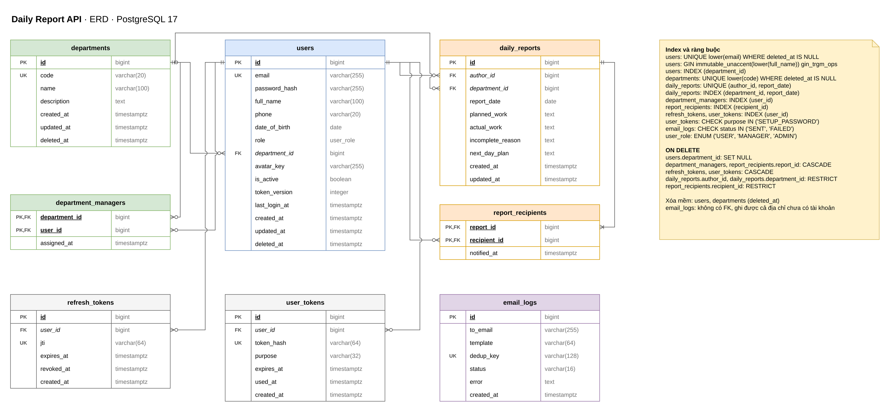
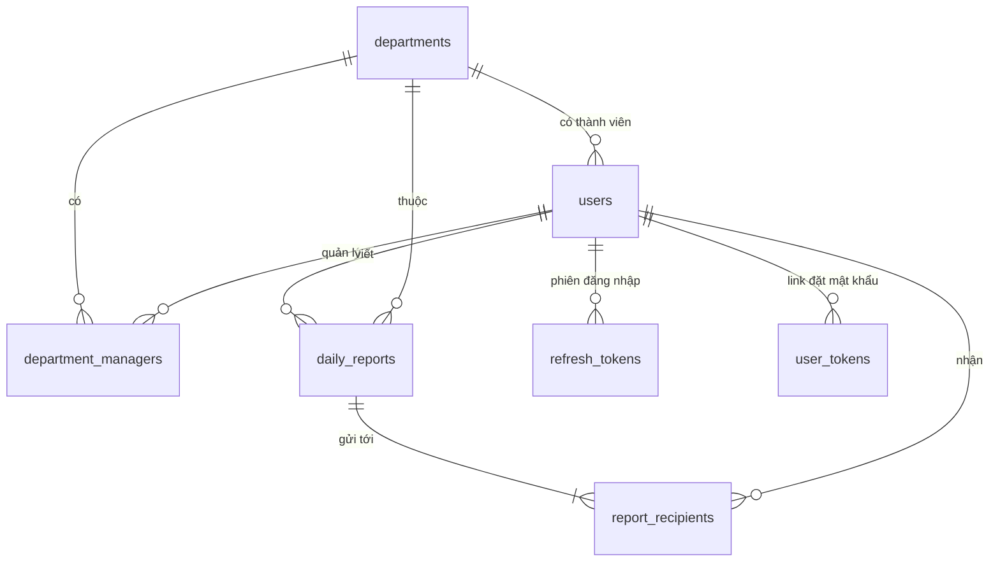

# Thiết kế cơ sở dữ liệu

PostgreSQL 17, 8 bảng. Bảng nghiệp vụ có `created_at`, `updated_at` kiểu `timestamptz` (UTC). `report_date` kiểu `date`, tính theo giờ Việt Nam.

Độ dài cột (varchar) khai báo một chỗ trong `src/app/core/constants.py`; model dùng cho `String(n)`, schema dùng cho `max_length` nên luôn khớp nhau. Migration ghi số trực tiếp vì là bản chụp schema tại thời điểm tạo.

Sơ đồ draw.io: [`database.drawio`](database.drawio). Mở bằng [app.diagrams.net](https://app.diagrams.net) hoặc extension Draw.io Integration của VS Code.



Thứ tự tạo bảng (xem `docs/progress/10-day-plan.md`):

| Migration | Ngày | Nội dung |
| --- | --- | --- |
| 0001 | 1 | Bật `unaccent`, `pg_trgm`, hàm `immutable_unaccent()` |
| 0002 | 1 | Bảng `users` (cho API đăng nhập ở bước B4) |
| 0003 | 2 | Các bảng còn lại và `users.department_id` (bước B5) |
| 0004 | 3 | `refresh_tokens.session_id` (phiên đăng nhập) |
| 0005 | 4 | GIN trigram cho `lower(email)` (admin tìm user theo email) |

## Quan hệ



## Bảng

### users (Ngày 1; `department_id`, `avatar_key` thêm ở Ngày 2)

| Cột | Kiểu | Ràng buộc | Ghi chú |
| --- | --- | --- | --- |
| id | bigint | PK, identity | |
| email | varchar(255) | not null | unique trên bản ghi chưa xóa |
| password_hash | varchar(255) | null | null đến khi user đặt mật khẩu qua link |
| full_name | varchar(100) | not null | |
| phone | varchar(20) | null | |
| date_of_birth | date | null | |
| role | enum `user_role` | not null, default `USER` | `USER`, `MANAGER`, `ADMIN` |
| department_id | bigint | FK → departments.id, null, on delete set null | theo Q1: 1 nhân viên 1 bộ phận |
| avatar_key | varchar(255) | null | đường dẫn ảnh đại diện trong kho lưu trữ (local hoặc S3) |
| is_active | boolean | not null, default true | khóa tài khoản |
| token_version | integer | not null, default 0 | tăng khi đổi mật khẩu, khóa, xóa |
| last_login_at | timestamptz | null | |
| created_at, updated_at | timestamptz | not null | |
| deleted_at | timestamptz | null | xóa mềm |

### departments (Ngày 2)

| Cột | Kiểu | Ràng buộc | Ghi chú |
| --- | --- | --- | --- |
| id | bigint | PK, identity | |
| code | varchar(20) | not null | unique trên bản ghi chưa xóa, không phân biệt hoa thường |
| name | varchar(100) | not null | |
| description | text | null | |
| created_at, updated_at, deleted_at | timestamptz | | xóa mềm |

### department_managers (Ngày 2)

| Cột | Kiểu | Ràng buộc |
| --- | --- | --- |
| department_id | bigint | PK, FK → departments.id, on delete cascade |
| user_id | bigint | PK, FK → users.id, on delete cascade |
| assigned_at | timestamptz | not null, default now() |

### daily_reports (Ngày 2)

| Cột | Kiểu | Ràng buộc | Ghi chú |
| --- | --- | --- | --- |
| id | bigint | PK, identity | |
| author_id | bigint | FK → users.id, not null, on delete restrict | |
| department_id | bigint | FK → departments.id, not null, on delete restrict | bộ phận tại thời điểm viết |
| report_date | date | not null | unique cùng author_id |
| planned_work | text | not null | công việc dự định |
| actual_work | text | not null | công việc thực tế đã làm |
| incomplete_reason | text | null | lý do không thể hoàn thành |
| next_day_plan | text | not null | công việc dự định ngày tiếp theo |
| created_at, updated_at | timestamptz | not null | |

### report_recipients (Ngày 2)

| Cột | Kiểu | Ràng buộc |
| --- | --- | --- |
| report_id | bigint | PK, FK → daily_reports.id, on delete cascade |
| recipient_id | bigint | PK, FK → users.id, on delete restrict |
| notified_at | timestamptz | null, ghi khi đã gửi mail S1 cho người này (cùng commit với dòng `email_logs`); task chạy lại bỏ qua người đã có giá trị |

### refresh_tokens (Ngày 2; `session_id` thêm ở Ngày 3)

Mỗi lần refresh tạo một dòng mới cùng `session_id`, dòng cũ được ghi `revoked_at`.

| Cột | Kiểu | Ràng buộc |
| --- | --- | --- |
| id | bigint | PK, identity |
| user_id | bigint | FK → users.id, not null, on delete cascade |
| jti | varchar(64) | not null, unique |
| session_id | varchar(64) | not null; mã phiên đăng nhập, giữ nguyên qua các lần refresh |
| expires_at | timestamptz | not null |
| revoked_at | timestamptz | null |
| created_at | timestamptz | not null |

### user_tokens (Ngày 2)

Link đặt mật khẩu lần đầu (S2, Ngày 7). Celery worker sinh token ngẫu nhiên 256 bit, chỉ lưu SHA-256; token gốc chỉ có trong email, không đi qua Redis. Gửi link mới thì xóa link cũ của user. Admin đổi email hoặc khóa, mở khóa user chưa đặt mật khẩu cũng xóa link cũ. Dùng xong ghi `used_at`.

| Cột | Kiểu | Ràng buộc |
| --- | --- | --- |
| id | bigint | PK, identity |
| user_id | bigint | FK → users.id, not null, on delete cascade |
| token_hash | varchar(64) | not null, unique, SHA-256 của token |
| purpose | varchar(32) | not null, `CHECK (purpose IN ('SETUP_PASSWORD'))` |
| expires_at | timestamptz | not null |
| used_at | timestamptz | null |
| created_at | timestamptz | not null |

### email_logs (Ngày 2)

| Cột | Kiểu | Ràng buộc | Ghi chú |
| --- | --- | --- | --- |
| id | bigint | PK, identity | |
| to_email | varchar(255) | not null | không FK, ghi được cả địa chỉ chưa có tài khoản |
| template | varchar(64) | not null | tên mẫu email (`EmailTemplate`): `test` (lệnh `send-test-email`), `report_created`, `account_setup`, `monthly_summary` |
| dedup_key | varchar(128) | null, unique | chống gửi trùng cho S3: `monthly:{tháng}:dept:{bộ phận}:user:{manager}`, ví dụ `monthly:2026-10:dept:3:user:7`. Worker ghi dòng `SENT` kèm key ngay trước khi gửi, cùng transaction với lần gửi; key đã có thì không gửi. Dòng `FAILED` không giữ key để chạy lại vẫn gửi được |
| status | varchar(16) | not null, `CHECK (status IN ('SENT', 'FAILED'))` | worker ghi một dòng cho mỗi email: `SENT` khi gửi được, `FAILED` khi hết 3 lần thử lại |
| error | text | null | lý do gửi lỗi |
| created_at | timestamptz | not null, default now() | |

## Ràng buộc và index

| Bảng | Index / ràng buộc | Mục đích |
| --- | --- | --- |
| users | `UNIQUE (lower(email)) WHERE deleted_at IS NULL` | email không trùng, không phân biệt hoa thường, cho phép tạo lại sau khi xóa mềm |
| users | `GIN (immutable_unaccent(lower(full_name)) gin_trgm_ops)` | tìm tên không dấu: "nguyen van a" khớp "Nguyễn Văn A" |
| users | `GIN (lower(email) gin_trgm_ops)` | tìm một phần email; cùng index tên ở trên, điều kiện "tên hoặc email" dùng được index (BitmapOr) thay vì quét cả bảng |
| users | `(department_id)` | lấy thành viên bộ phận |
| departments | `UNIQUE (lower(code)) WHERE deleted_at IS NULL` | mã bộ phận không trùng, không phân biệt hoa thường (như email) |
| department_managers | `(user_id)` | lấy các bộ phận một manager quản lý, dùng khi kiểm tra quyền |
| daily_reports | `UNIQUE (author_id, report_date)` | mỗi người 1 báo cáo / ngày; thống kê tháng đếm báo cáo theo người viết |
| daily_reports | `(department_id, report_date) INCLUDE (author_id, id)` | màn hình manager, export; `INCLUDE` để danh sách báo cáo của manager đếm và chọn trang chỉ bằng index (mục Hiệu năng truy vấn) |
| report_recipients | `(recipient_id)` | báo cáo gửi tới một manager |
| refresh_tokens | `(user_id)` | thu hồi mọi phiên của một user; xóa cascade không phải quét cả bảng |
| refresh_tokens | `(session_id)` | đăng xuất thu hồi mọi refresh token của một phiên |
| user_tokens | `(user_id)` | vô hiệu link cũ khi gửi link mới; xóa cascade không phải quét cả bảng |

PostgreSQL không tự tạo index cho khóa ngoại. Mọi cột khóa ngoại ở trên đều có index riêng hoặc là cột đầu của một index (khóa chính ghép, unique) nên tra cứu và xóa không phải quét cả bảng.

## Chính sách khi xóa

User và bộ phận chỉ xóa mềm (`deleted_at`), nên các quy tắc dưới đây là lớp bảo vệ cuối khi có lệnh xóa cứng.

| Khóa ngoại | ON DELETE | Lý do |
| --- | --- | --- |
| `users.department_id` → departments | SET NULL | nhân viên còn lại, chỉ mất liên kết bộ phận |
| `department_managers.*` → departments, users | CASCADE | bảng liên kết, không còn ý nghĩa khi một phía bị xóa |
| `daily_reports.author_id` → users | RESTRICT | giữ lịch sử báo cáo |
| `daily_reports.department_id` → departments | RESTRICT | giữ lịch sử báo cáo và thống kê |
| `report_recipients.report_id` → daily_reports | CASCADE | người nhận đi theo báo cáo |
| `report_recipients.recipient_id` → users | RESTRICT | giữ lịch sử ai đã nhận báo cáo |
| `refresh_tokens.user_id`, `user_tokens.user_id` → users | CASCADE | token không còn ý nghĩa khi user bị xóa |

Tên constraint, index sinh theo naming convention trong `src/app/core/database.py` để migration ổn định.

## Quyết định thiết kế

| Vấn đề | Chọn | Lý do |
| --- | --- | --- |
| Kiểu khóa chính | `bigint` identity | Index nhỏ, sắp xếp theo thời gian tạo, dễ đọc khi debug. ID lộ ra URL không phải rủi ro vì mọi endpoint đều kiểm tra quyền theo phạm vi; truy cập ngoài phạm vi trả 404. |
| Manager của bộ phận | Bảng nhiều–nhiều `department_managers` | Requirement có “thêm/xóa manager cho một bộ phận” và “danh sách bộ phận của mình”, tức một bộ phận có thể nhiều manager, một manager quản lý nhiều bộ phận (Q2). Một cột `departments.manager_id` không biểu diễn được. |
| Nhân viên thuộc bộ phận | Cột `users.department_id` | Mỗi nhân viên một bộ phận (Q1). Nếu PM chốt nhiều bộ phận thì đổi sang bảng liên kết. |
| Role | Enum `user_role` trên `users` | Chỉ có 3 role cố định, không cần bảng role/permission. |
| Giá trị cố định dạng chuỗi | varchar + `CHECK` | `user_tokens.purpose`, `email_logs.status`: thêm giá trị mới chỉ cần sửa CHECK, không phải `ALTER TYPE`. |

## Tìm kiếm tiếng Việt không dấu

Hàm `unaccent()` của PostgreSQL là `STABLE` nên không dùng trực tiếp trong index được. Migration 0001 tạo hàm bọc `immutable_unaccent(text)` (IMMUTABLE) và bật `unaccent`, `pg_trgm`. Truy vấn tìm kiếm dùng cùng biểu thức với index:

```sql
WHERE immutable_unaccent(lower(full_name)) LIKE '%' || immutable_unaccent(lower(:keyword)) || '%'
```

## Hiệu năng truy vấn

### Không có N+1

- Quan hệ ORM để `lazy="raise"`: quên nạp quan hệ thì lỗi ngay trong test, không âm thầm chạy thêm một câu SQL cho mỗi dòng. Dữ liệu kèm theo lấy trong cùng câu (`contains_eager`, `joinedload`) hoặc một câu cho cả trang (cờ `is_manager` của danh sách thành viên).
- `tests/api/test_list_endpoints.py` lấy mọi endpoint GET trả danh sách từ route của app, gọi mỗi endpoint khi danh sách có 1 phần tử và 5 phần tử: số câu SQL hai lần phải bằng nhau và bằng số trong bảng dưới. Endpoint mới trả danh sách mà chưa có trong test thì test đỏ. Endpoint ghi nhận một danh sách đếm theo cùng cách.

| Endpoint | Số câu | Các câu |
| --- | --- | --- |
| `GET /me/recipients` | 2 | user đăng nhập, danh sách |
| `GET /me/reports` | 3 | user, đếm, trang |
| `GET /me/reports/{id}` | 3 | user, báo cáo kèm bộ phận, người nhận |
| `GET /admin/users`, `GET /admin/departments` | 3 | user, đếm, trang |
| `GET /admin/departments/{id}/members` | 5 | user, bộ phận, đếm, trang, cờ manager của cả trang |
| `GET /admin/departments/{id}/managers` | 4 | user, bộ phận, đếm, trang |
| `GET /manager/departments` | 3 | user, đếm, trang |
| `GET /manager/departments/{department_id}` | 4 | user, bộ phận trong phạm vi, manager, số thành viên |
| `GET /manager/departments/{department_id}/members` | 5 | user, bộ phận trong phạm vi, đếm, trang, cờ manager của cả trang |
| `GET /manager/candidates`, `GET /manager/employees` | 3 | user, đếm, trang |
| `GET /manager/reports` | 3 | user, đếm, trang kèm người viết |
| `GET /manager/reports/{report_id}` | 3 | user, báo cáo kèm bộ phận và người viết, người nhận |
| `GET /manager/reports/export` | 2 | user, mọi dòng của file trong một câu |
| `POST /me/reports` | 5 | user, trùng ngày, người nhận hợp lệ, thêm báo cáo, thêm mọi người nhận (một lệnh `executemany`) |
| `POST /manager/departments/{department_id}/members` | 4 | user, khóa bộ phận, khóa các user, cập nhật (một lệnh `executemany`) |
| `POST /admin/users/import` | 4 | user, khóa bộ phận theo mã, email đã có, thêm mọi user trong một câu `INSERT` |

Lọc theo `department_id` (`/manager/employees`, `/manager/reports`, export) thêm một câu kiểm tra bộ phận thuộc phạm vi.

### Phân trang

Mọi danh sách có thể lớn dần (user, bộ phận, báo cáo, nhân viên) đều phân trang, `page_size` tối đa 100 (`MAX_PAGE_SIZE`), `page` tối đa 1.000.000. Không phân trang, có test liệt kê đúng các chỗ này:

- `GET /me/recipients`, `managers` trong `GET /manager/departments/{department_id}`: manager của một bộ phận, do admin gán, ít người. Màn hình tạo báo cáo cần cả danh sách để chọn người nhận.
- `recipients` trong chi tiết báo cáo: người nhận của một báo cáo, tối đa 50 khi chọn, hoặc là các manager của bộ phận.
- Export Excel: báo cáo của một ngày, mỗi nhân viên trong phạm vi một dòng.

### Đo trên dữ liệu lớn

Dữ liệu đo: 100 bộ phận, 10.010 user (9.500 nhân viên, mỗi bộ phận 95 người, mỗi bộ phận 3 manager, một manager quản lý 10 bộ phận), mỗi nhân viên một báo cáo mỗi ngày làm việc trong một năm (2,47 triệu báo cáo). PostgreSQL 17 trong Docker trên máy dev, cấu hình mặc định (`shared_buffers` 128 MB, bảng báo cáo khoảng 670 MB nên không nằm hết trong cache). Gọi API thật qua ASGI, mỗi trường hợp 5 lần sau một lần làm ấm, lấy trung vị; chạy lại từng câu SQL bằng `EXPLAIN (ANALYZE, BUFFERS)`.

Tìm kiếm user (theo tên, email), danh sách bộ phận, thành viên, ứng viên, nhân viên, lịch sử báo cáo của tôi, chi tiết báo cáo: dưới 10 ms. Tìm tên, email dùng hai GIN index (BitmapOr); lịch sử báo cáo của tôi đọc ngược unique index `(author_id, report_date)` và dừng sau đủ một trang. Export một ngày cho 10 bộ phận (950 dòng) khoảng 130 ms, phần lớn là ghi file Excel.

Chỗ chậm duy nhất là `GET /manager/reports` khi không lọc ngày: phải đếm và sắp mọi báo cáo của các bộ phận từ trước tới nay rồi mới cắt trang. Trước đây câu lấy trang đọc đủ cột của mọi báo cáo trong phạm vi để sắp (mỗi báo cáo một lần đọc ngẫu nhiên, bộ phận 95 người một năm là 24.700 lần), câu đếm cũng phải đọc bảng để lấy người viết. Nay index có thêm `author_id`, `id` (`INCLUDE`), câu đếm và câu chọn id của trang chỉ đọc index (Index Only Scan) và bảng users; đủ cột chỉ đọc cho các báo cáo trong trang, theo khóa chính, vẫn trong một câu SQL.

| `GET /manager/reports` | `total` | Trước | Sau |
| --- | --- | --- | --- |
| 1 bộ phận, mặc định | 24.700 | 342 ms | 60 ms |
| 10 bộ phận, mặc định | 247.000 | 2.670 ms | 411 ms |
| 10 bộ phận, sắp theo tên | 247.000 | 1.266 ms | 408 ms |
| 10 bộ phận, tìm theo tên | 18.460 | 302 ms | 85 ms |
| 10 bộ phận, một tháng | 14.250 | 55 ms | 34 ms |
| 10 bộ phận, trang cuối (`page_size` 100) | 247.000 | 2.977 ms | 562 ms |

Còn lại: manager nhiều bộ phận xem không lọc ngày vẫn khoảng 0,4 s. Theo EXPLAIN, gần hết thời gian là tính khóa sắp theo tên `immutable_unaccent(lower(full_name))` cho từng báo cáo (247.000 lần). Muốn nhanh hơn thì lưu sẵn khóa này thành cột của `users` (generated column) để mỗi user chỉ tính một lần, đổi cả `order_by_full_name()` và GIN index tên. Chưa làm vì đụng schema users và mọi danh sách sắp theo tên, trong khi màn hình thường lọc theo khoảng ngày (một tháng: 34 ms).
