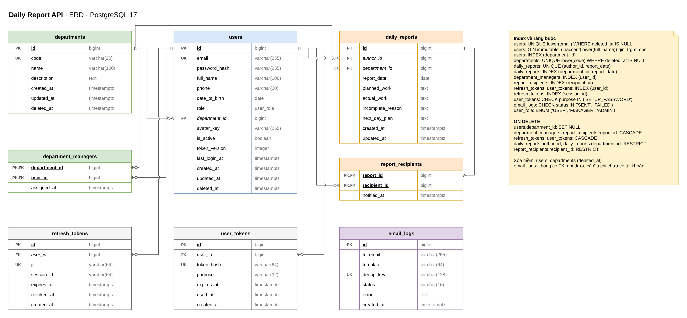
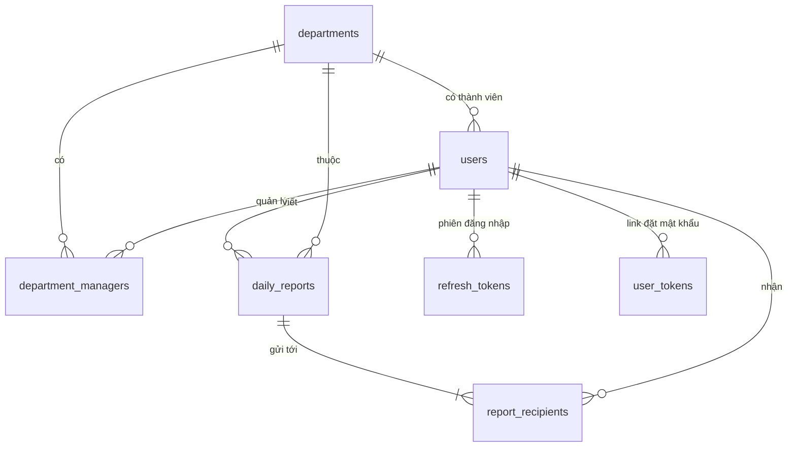

# Thiết kế cơ sở dữ liệu

PostgreSQL 17, 8 bảng. Bảng nghiệp vụ có `created_at`, `updated_at` kiểu `timestamptz` (UTC). `report_date` kiểu `date`, tính theo giờ Việt Nam.

Độ dài cột (varchar) khai báo một chỗ trong `src/app/core/constants.py`; model dùng cho `String(n)`, schema dùng cho `max_length` nên luôn khớp nhau. Migration ghi số trực tiếp vì là bản chụp schema tại thời điểm tạo.

Sơ đồ draw.io: [`database.drawio`](database.drawio). Mở bằng [app.diagrams.net](https://app.diagrams.net) hoặc extension Draw.io Integration của VS Code.



Thứ tự tạo bảng (xem `docs/progress/10-day-plan.md`):

| Migration | Ngày | Nội dung |
| --- | --- | --- |
| 0001 | 1 | Bật `unaccent`, `pg_trgm`, hàm `immutable_unaccent()` |
| 0002 | 1 | Bảng `users` (cho API đăng nhập ở bước B4) |
| 0003 | 2 | Các bảng còn lại và `users.department_id` (bước B5) |

## Quan hệ



## Bảng

### users (Ngày 1; `department_id`, `avatar_key` thêm ở Ngày 2)

| Cột | Kiểu | Ràng buộc | Ghi chú |
| --- | --- | --- | --- |
| id | bigint | PK, identity | |
| email | varchar(255) | not null | unique trên bản ghi chưa xóa |
| password_hash | varchar(255) | null | null đến khi user đặt mật khẩu qua link |
| full_name | varchar(100) | not null | |
| phone | varchar(20) | null | |
| date_of_birth | date | null | |
| role | enum `user_role` | not null, default `USER` | `USER`, `MANAGER`, `ADMIN` |
| department_id | bigint | FK → departments.id, null, on delete set null | theo Q1: 1 nhân viên 1 bộ phận |
| avatar_key | varchar(255) | null | đường dẫn ảnh đại diện trong kho lưu trữ (local hoặc S3) |
| is_active | boolean | not null, default true | khóa tài khoản |
| token_version | integer | not null, default 0 | tăng khi đổi mật khẩu, khóa, xóa |
| last_login_at | timestamptz | null | |
| created_at, updated_at | timestamptz | not null | |
| deleted_at | timestamptz | null | xóa mềm |

### departments (Ngày 2)

| Cột | Kiểu | Ràng buộc | Ghi chú |
| --- | --- | --- | --- |
| id | bigint | PK, identity | |
| code | varchar(20) | not null | unique trên bản ghi chưa xóa, không phân biệt hoa thường |
| name | varchar(100) | not null | |
| description | text | null | |
| created_at, updated_at, deleted_at | timestamptz | | xóa mềm |

### department_managers (Ngày 2)

| Cột | Kiểu | Ràng buộc |
| --- | --- | --- |
| department_id | bigint | PK, FK → departments.id, on delete cascade |
| user_id | bigint | PK, FK → users.id, on delete cascade |
| assigned_at | timestamptz | not null, default now() |

### daily_reports (Ngày 2)

| Cột | Kiểu | Ràng buộc | Ghi chú |
| --- | --- | --- | --- |
| id | bigint | PK, identity | |
| author_id | bigint | FK → users.id, not null, on delete restrict | |
| department_id | bigint | FK → departments.id, not null, on delete restrict | bộ phận tại thời điểm viết |
| report_date | date | not null | unique cùng author_id |
| planned_work | text | not null | công việc dự định |
| actual_work | text | not null | công việc thực tế đã làm |
| incomplete_reason | text | null | lý do không thể hoàn thành |
| next_day_plan | text | not null | công việc dự định ngày tiếp theo |
| created_at, updated_at | timestamptz | not null | |

### report_recipients (Ngày 2)

| Cột | Kiểu | Ràng buộc |
| --- | --- | --- |
| report_id | bigint | PK, FK → daily_reports.id, on delete cascade |
| recipient_id | bigint | PK, FK → users.id, on delete restrict |
| notified_at | timestamptz | null, ghi khi đã gửi mail S1 |

### refresh_tokens (Ngày 2; `session_id` thêm ở Ngày 3)

Mỗi lần refresh tạo một dòng mới cùng `session_id`, dòng cũ được ghi `revoked_at`.

| Cột | Kiểu | Ràng buộc |
| --- | --- | --- |
| id | bigint | PK, identity |
| user_id | bigint | FK → users.id, not null, on delete cascade |
| jti | varchar(64) | not null, unique |
| session_id | varchar(64) | not null; mã phiên đăng nhập, giữ nguyên qua các lần refresh |
| expires_at | timestamptz | not null |
| revoked_at | timestamptz | null |
| created_at | timestamptz | not null |

### user_tokens (Ngày 2)

| Cột | Kiểu | Ràng buộc |
| --- | --- | --- |
| id | bigint | PK, identity |
| user_id | bigint | FK → users.id, not null, on delete cascade |
| token_hash | varchar(64) | not null, unique, SHA-256 của token |
| purpose | varchar(32) | not null, `CHECK (purpose IN ('SETUP_PASSWORD'))` |
| expires_at | timestamptz | not null |
| used_at | timestamptz | null |
| created_at | timestamptz | not null |

### email_logs (Ngày 2)

| Cột | Kiểu | Ràng buộc | Ghi chú |
| --- | --- | --- | --- |
| id | bigint | PK, identity | |
| to_email | varchar(255) | not null | không FK, ghi được cả địa chỉ chưa có tài khoản |
| template | varchar(64) | not null | `report_created`, `account_setup`, `monthly_summary` |
| dedup_key | varchar(128) | null, unique | chống gửi trùng cho S3 (ví dụ `monthly:2026-10:dept:3:user:7`) |
| status | varchar(16) | not null, `CHECK (status IN ('SENT', 'FAILED'))` | |
| error | text | null | lý do gửi lỗi |
| created_at | timestamptz | not null, default now() | |

## Ràng buộc và index

| Bảng | Index / ràng buộc | Mục đích |
| --- | --- | --- |
| users | `UNIQUE (lower(email)) WHERE deleted_at IS NULL` | email không trùng, không phân biệt hoa thường, cho phép tạo lại sau khi xóa mềm |
| users | `GIN (immutable_unaccent(lower(full_name)) gin_trgm_ops)` | tìm tên không dấu: "nguyen van a" khớp "Nguyễn Văn A" |
| users | `(department_id)` | lấy thành viên bộ phận |
| departments | `UNIQUE (lower(code)) WHERE deleted_at IS NULL` | mã bộ phận không trùng, không phân biệt hoa thường (như email) |
| department_managers | `(user_id)` | lấy các bộ phận một manager quản lý, dùng khi kiểm tra quyền |
| daily_reports | `UNIQUE (author_id, report_date)` | mỗi người 1 báo cáo / ngày |
| daily_reports | `(department_id, report_date)` | màn hình manager, export, thống kê tháng |
| report_recipients | `(recipient_id)` | báo cáo gửi tới một manager |
| refresh_tokens | `(user_id)` | thu hồi mọi phiên của một user; xóa cascade không phải quét cả bảng |
| refresh_tokens | `(session_id)` | đăng xuất thu hồi mọi refresh token của một phiên |
| user_tokens | `(user_id)` | vô hiệu link cũ khi gửi link mới; xóa cascade không phải quét cả bảng |

PostgreSQL không tự tạo index cho khóa ngoại. Mọi cột khóa ngoại ở trên đều có index riêng hoặc là cột đầu của một index (khóa chính ghép, unique) nên tra cứu và xóa không phải quét cả bảng.

## Chính sách khi xóa

User và bộ phận chỉ xóa mềm (`deleted_at`), nên các quy tắc dưới đây là lớp bảo vệ cuối khi có lệnh xóa cứng.

| Khóa ngoại | ON DELETE | Lý do |
| --- | --- | --- |
| `users.department_id` → departments | SET NULL | nhân viên còn lại, chỉ mất liên kết bộ phận |
| `department_managers.*` → departments, users | CASCADE | bảng liên kết, không còn ý nghĩa khi một phía bị xóa |
| `daily_reports.author_id` → users | RESTRICT | giữ lịch sử báo cáo |
| `daily_reports.department_id` → departments | RESTRICT | giữ lịch sử báo cáo và thống kê |
| `report_recipients.report_id` → daily_reports | CASCADE | người nhận đi theo báo cáo |
| `report_recipients.recipient_id` → users | RESTRICT | giữ lịch sử ai đã nhận báo cáo |
| `refresh_tokens.user_id`, `user_tokens.user_id` → users | CASCADE | token không còn ý nghĩa khi user bị xóa |

Tên constraint, index sinh theo naming convention trong `src/app/core/database.py` để migration ổn định.

## Quyết định thiết kế

| Vấn đề | Chọn | Lý do |
| --- | --- | --- |
| Kiểu khóa chính | `bigint` identity | Index nhỏ, sắp xếp theo thời gian tạo, dễ đọc khi debug. ID lộ ra URL không phải rủi ro vì mọi endpoint đều kiểm tra quyền theo phạm vi; truy cập ngoài phạm vi trả 404. |
| Manager của bộ phận | Bảng nhiều–nhiều `department_managers` | Requirement có “thêm/xóa manager cho một bộ phận” và “danh sách bộ phận của mình”, tức một bộ phận có thể nhiều manager, một manager quản lý nhiều bộ phận (Q2). Một cột `departments.manager_id` không biểu diễn được. |
| Nhân viên thuộc bộ phận | Cột `users.department_id` | Mỗi nhân viên một bộ phận (Q1). Nếu PM chốt nhiều bộ phận thì đổi sang bảng liên kết. |
| Role | Enum `user_role` trên `users` | Chỉ có 3 role cố định, không cần bảng role/permission. |
| Giá trị cố định dạng chuỗi | varchar + `CHECK` | `user_tokens.purpose`, `email_logs.status`: thêm giá trị mới chỉ cần sửa CHECK, không phải `ALTER TYPE`. |

## Tìm kiếm tiếng Việt không dấu

Hàm `unaccent()` của PostgreSQL là `STABLE` nên không dùng trực tiếp trong index được. Migration 0001 tạo hàm bọc `immutable_unaccent(text)` (IMMUTABLE) và bật `unaccent`, `pg_trgm`. Truy vấn tìm kiếm dùng cùng biểu thức với index:

```sql
WHERE immutable_unaccent(lower(full_name)) LIKE '%' || immutable_unaccent(lower(:keyword)) || '%'
```
