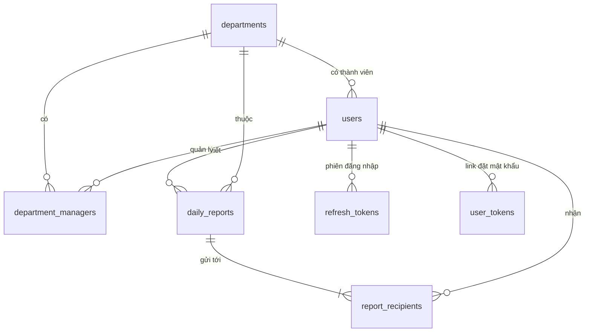

# Thiết kế cơ sở dữ liệu

PostgreSQL 17, 8 bảng. Bảng nghiệp vụ có `created_at`, `updated_at` kiểu `timestamptz` (UTC). `report_date` kiểu `date`, tính theo giờ Việt Nam.

Sơ đồ draw.io: [`database.drawio`](database.drawio). Mở bằng [app.diagrams.net](https://app.diagrams.net) hoặc extension Draw.io Integration của VS Code.


Thứ tự tạo bảng (xem `docs/progress/10-day-plan.md`):

| Migration | Ngày | Nội dung |
| --- | --- | --- |
| 0001 | 1 | Bật `unaccent`, `pg_trgm`, hàm `immutable_unaccent()` |
| 0002 | 1 | Bảng `users` (cho API đăng nhập ở bước B4) |
| 0003 | 2 | Các bảng còn lại và `users.department_id` (bước B5) |

## Quan hệ



## Bảng

### users (Ngày 1; `department_id`, `avatar_key` thêm ở Ngày 2)

| Cột | Kiểu | Ràng buộc | Ghi chú |
| --- | --- | --- | --- |
| id | bigint | PK, identity | |
| email | varchar(255) | not null | unique trên bản ghi chưa xóa |
| password_hash | varchar(255) | null | null đến khi user đặt mật khẩu qua link |
| full_name | varchar(100) | not null | |
| phone | varchar(20) | null | |
| date_of_birth | date | null | |
| role | enum `user_role` | not null, default `USER` | `USER`, `MANAGER`, `ADMIN` |
| department_id | bigint | FK → departments.id, null, on delete set null | theo Q1: 1 nhân viên 1 bộ phận |
| avatar_key | varchar(255) | null | đường dẫn ảnh đại diện trong kho lưu trữ (local hoặc S3) |
| is_active | boolean | not null, default true | khóa tài khoản |
| token_version | integer | not null, default 0 | tăng khi đổi mật khẩu, khóa, xóa |
| last_login_at | timestamptz | null | |
| created_at, updated_at | timestamptz | not null | |
| deleted_at | timestamptz | null | xóa mềm |

### departments (Ngày 2)

| Cột | Kiểu | Ràng buộc | Ghi chú |
| --- | --- | --- | --- |
| id | bigint | PK | |
| code | varchar(20) | not null | unique trên bản ghi chưa xóa |
| name | varchar(100) | not null | |
| description | text | null | |
| created_at, updated_at, deleted_at | timestamptz | | xóa mềm |

### department_managers (Ngày 2)

| Cột | Kiểu | Ràng buộc |
| --- | --- | --- |
| department_id | bigint | PK, FK → departments.id, on delete cascade |
| user_id | bigint | PK, FK → users.id, on delete cascade |
| assigned_at | timestamptz | not null, default now() |

### daily_reports (Ngày 2)

| Cột | Kiểu | Ràng buộc | Ghi chú |
| --- | --- | --- | --- |
| id | bigint | PK | |
| author_id | bigint | FK → users.id, not null | |
| department_id | bigint | FK → departments.id, not null | bộ phận tại thời điểm viết |
| report_date | date | not null | unique cùng author_id |
| planned_work | text | not null | công việc dự định |
| actual_work | text | not null | công việc thực tế đã làm |
| incomplete_reason | text | null | lý do không thể hoàn thành |
| next_day_plan | text | not null | công việc dự định ngày tiếp theo |
| created_at, updated_at | timestamptz | not null | |

### report_recipients (Ngày 2)

| Cột | Kiểu | Ràng buộc |
| --- | --- | --- |
| report_id | bigint | PK, FK → daily_reports.id, on delete cascade |
| recipient_id | bigint | PK, FK → users.id |
| notified_at | timestamptz | null, ghi khi đã gửi mail S1 |

### refresh_tokens (Ngày 2)

| Cột | Kiểu | Ràng buộc |
| --- | --- | --- |
| id | bigint | PK |
| user_id | bigint | FK → users.id, on delete cascade |
| jti | varchar(64) | unique |
| expires_at | timestamptz | not null |
| revoked_at | timestamptz | null |
| created_at | timestamptz | not null |

### user_tokens (Ngày 2)

| Cột | Kiểu | Ràng buộc |
| --- | --- | --- |
| id | bigint | PK |
| user_id | bigint | FK → users.id, on delete cascade |
| token_hash | varchar(64) | unique, SHA-256 của token |
| purpose | varchar(32) | `SETUP_PASSWORD` |
| expires_at | timestamptz | not null |
| used_at | timestamptz | null |
| created_at | timestamptz | not null |

### email_logs (Ngày 2)

| Cột | Kiểu | Ghi chú |
| --- | --- | --- |
| id | bigint | PK |
| to_email | varchar(255) | không FK, ghi được cả địa chỉ chưa có tài khoản |
| template | varchar(64) | `report_created`, `account_setup`, `monthly_summary` |
| dedup_key | varchar(128) | unique, null; chống gửi trùng cho S3 (ví dụ `monthly:2026-10:dept:3:user:7`) |
| status | varchar(16) | `SENT`, `FAILED` |
| error | text | null |
| created_at | timestamptz | |

## Ràng buộc và index

| Bảng | Index / ràng buộc | Mục đích |
| --- | --- | --- |
| users | `UNIQUE (lower(email)) WHERE deleted_at IS NULL` | email không trùng, không phân biệt hoa thường, cho phép tạo lại sau khi xóa mềm |
| users | `GIN (immutable_unaccent(lower(full_name)) gin_trgm_ops)` | tìm tên không dấu: "nguyen van a" khớp "Nguyễn Văn A" |
| users | `(department_id)` | lấy thành viên bộ phận |
| departments | `UNIQUE (code) WHERE deleted_at IS NULL` | mã bộ phận không trùng |
| department_managers | `(user_id)` | lấy các bộ phận một manager quản lý, dùng khi kiểm tra quyền |
| daily_reports | `UNIQUE (author_id, report_date)` | mỗi người 1 báo cáo / ngày |
| daily_reports | `(department_id, report_date)` | màn hình manager, export, thống kê tháng |
| report_recipients | `(recipient_id)` | báo cáo gửi tới một manager |

Tên constraint, index sinh theo naming convention trong `src/app/core/database.py` để migration ổn định.

## Tìm kiếm tiếng Việt không dấu

Hàm `unaccent()` của PostgreSQL là `STABLE` nên không dùng trực tiếp trong index được. Migration 0001 tạo hàm bọc `immutable_unaccent(text)` (IMMUTABLE) và bật `unaccent`, `pg_trgm`. Truy vấn tìm kiếm dùng cùng biểu thức với index:

```sql
WHERE immutable_unaccent(lower(full_name)) LIKE '%' || immutable_unaccent(lower(:keyword)) || '%'
```
